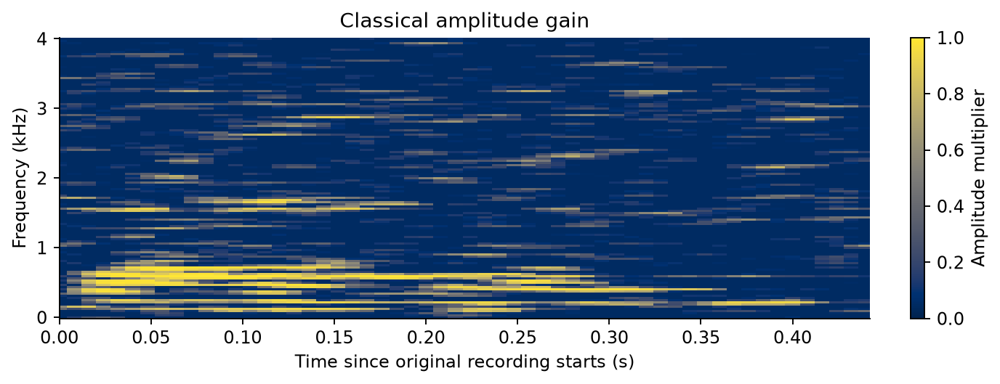

# DFT-based speech denoising

Classical speech enhancement using the short-time Fourier transform, calibrated
noise-power estimation and Wiener-style spectral gains. A constant-gain control
checks whether the improvement goes beyond simply reducing waveform amplitude.

<p align="center">
  
</p>

The gain map for the prespecified example shows which Fourier coefficients are
retained or attenuated. It is a computed experimental plot, not an illustration.

## Project structure

| Location | Purpose |
|---|---|
| `speech_dft/core.py` | STFT, spectral gains, reconstruction and scoring |
| `speech_dft/experiment.py` | Main experiment and plots |
| `speech_dft/comparison.py` | Constant-gain control |
| `speech_dft/data.py` | Dataset download and checksum verification |
| `speech_dft/experiment_results.py` | Main-result checks and report tables |
| `speech_dft/comparison_results.py` | Control-result checks and report table |
| `speech_dft/teaching_figures.py` | Mathematical teaching plots |
| `speech_dft/verify.py` | Reference checks and numerical result comparison |
| `reference/` | Recorded reference scores and metadata |
| `tests/` | Numerical and setup checks |

Read [the project history](PROJECT_HISTORY.md) for the design decisions, or
[the reproducibility guide](docs/REPRODUCIBILITY.md) for the full protocol.

## Installation

Use Python **3.12**. From the project root:

```sh
python3.12 -m venv .venv
source .venv/bin/activate
python -m pip install -r requirements.txt
python -m unittest discover -s tests
```

In VS Code, select `.venv/bin/python`. On Windows, activate the environment with
`.venv\Scripts\Activate.ps1` in PowerShell instead.

## Data

Download and verify Free Spoken Digit Dataset v1.0.10:

```sh
python -m speech_dft.data
python -m speech_dft.experiment doctor
```

If you already have the recordings, use their location instead:

```sh
export DFT_DATA="/absolute/path/to/recordings"
python -m speech_dft.experiment doctor
```

The setup check should find 3,000 mono WAV files at 8 kHz. Individual experiment
commands also accept `--data PATH`. Audio, environments, caches and generated
runs are excluded from version control. Dataset attribution and its CC BY-SA 4.0
licence are available in the [FSDD source](https://github.com/Jakobovski/free-spoken-digit-dataset/tree/v1.0.10).

## Main experiment

Run the stages in order, keeping the same run name:

```sh
python -m speech_dft.experiment inspect --run baseline
python -m speech_dft.experiment toy --run baseline
python -m speech_dft.experiment select --run baseline
python -m speech_dft.experiment evaluate --run baseline
python -m speech_dft.experiment plot --run baseline
python -m speech_dft.experiment_results --run baseline
```

Results are written to `results/experiments/baseline/`. Validation selects the
smoothing parameter; evaluation scores 6,000 test mixtures. Use a new run name
when changing code, data or environment. Source and environment checks prevent
silently mixing incompatible stages.

For a short execution check, choose another name, such as `smoke`, and add
`--smoke` to all five `experiment` commands. The report-table command requires
a full run. Smoke outputs are execution checks, not report evidence.

## Constant-gain control

After completing a full main run:

```sh
python -m speech_dft.comparison select --run baseline
python -m speech_dft.comparison evaluate --run baseline
python -m speech_dft.comparison_results --run baseline
```

One gain is selected on validation recordings and fixed across all test
conditions. Outputs are written to `results/comparisons/global-gain-baseline/`.

## Verification and teaching figures

Compare saved numerical results with the reference outputs:

```sh
python -m speech_dft.verify --run baseline --comparison
```

To check reference-file integrity alone, omit `--run` and `--comparison`.
Neither verification command performs denoising. Generate the separate analytic
teaching figures with:

```sh
python -m speech_dft.teaching_figures
```

These are written to `results/teaching/`. For command options, append `--help`
to the corresponding module command.

## Reference results and scope

Mean reconstruction SNR, in dB:

| Background | 0 dB input | 5 dB input | 10 dB input |
|---|---:|---:|---:|
| White | 8.67 | 12.20 | 15.58 |
| Coloured | 6.66 | 10.12 | 13.90 |

The test uses stationary synthetic noise, a supplied noise-only calibration
interval and recordings from two test speakers. All 6,000 tested mixtures
improved over the unprocessed signal and the validation-selected constant-gain
control. This does not establish universal success or improved intelligibility.
The control is a supplementary comparison introduced after the initial results
were inspected.

See [verification and provenance](docs/PROVENANCE.md) for the recorded numerical
checks and their limits.

## Licence and attribution

Code is available under the [MIT licence](LICENSE), copyright 2026 Jayant Nagpal.
The Free Spoken Digit Dataset is licensed separately under CC BY-SA 4.0 and is
not redistributed here. Its release and attribution are linked in the Data section.

OpenAI's generative AI assistant was used for conceptual explanations, research,
code development, debugging, documentation and interpretation of saved results.
I executed the full reproduction on my system. The numerical protocol and its
limitations are documented above and in the reproducibility guide.
